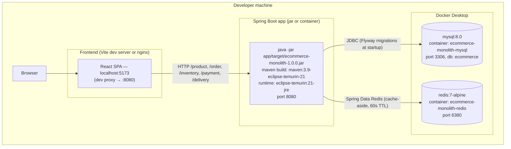

# Deployment diagram — ecommerce-monolith

Compose services: `mysql` (healthcheck `mysqladmin ping`), `redis` (healthcheck `redis-cli ping`). The app can run on the host (default) or as a container built from the multi-stage Dockerfile.
