# ER diagram — write model + read models (one MySQL schema)

```mermaid
erDiagram
    categories ||--o{ product_categories : ""
    products   ||--o{ product_categories : ""

    orders ||--|{ order_items : contains
    reservations ||--|{ reservation_items : contains

    order_read_model {
        varchar id PK
        varchar user_id
        varchar status "PENDING..CONFIRMED"
        decimal total_amount
        text items "JSON array"
        varchar street
        varchar city
        varchar zip
        varchar country
        datetime created_at
    }

    inventory_read_model {
        varchar product_id PK
        int available_qty
        int reserved_qty
    }

    payment_read_model {
        varchar id PK
        varchar order_id UK
        decimal amount
        varchar status "COMPLETED|FAILED"
        varchar card_last4
        varchar failure_reason
        datetime created_at
    }

    delivery_read_model {
        varchar id PK
        varchar order_id UK
        varchar status "SCHEDULED.."
        varchar street
        varchar city
        varchar zip
        varchar country
        datetime created_at
    }

    product_read_model {
        varchar id PK
        varchar title
        text description
        decimal price
        varchar categories "comma-separated names"
        datetime created_at
    }

    category_read_model {
        varchar id PK
        varchar name UK
    }

    products {
        varchar id PK
        varchar title
        text description
        decimal price "CHECK price > 0"
    }

    categories {
        varchar id PK
        varchar name UK
    }

    product_categories {
        varchar product_id PK_FK
        varchar category_id PK_FK
    }

    orders {
        varchar id PK
        varchar user_id
        varchar status "PENDING..CONFIRMED"
        decimal total_amount
        varchar street
        varchar city
        varchar zip
        varchar country
        varchar card_last4 "only last-4 stored"
        datetime created_at
    }

    order_items {
        bigint id PK
        varchar order_id FK
        varchar product_id
        int quantity "CHECK >= 1"
        decimal unit_price
    }

    inventory {
        varchar product_id PK
        int available_qty "CHECK >= 0"
    }

    known_products {
        varchar product_id PK "learned via ProductCreated"
        varchar title
    }

    reservations {
        varchar id PK
        varchar order_id UK
        varchar status "ACTIVE|RELEASED"
    }

    reservation_items {
        bigint id PK
        varchar reservation_id FK
        varchar product_id
        int quantity
        decimal unit_price
    }

    payments {
        varchar id PK
        varchar order_id UK
        decimal amount
        varchar status "PENDING|COMPLETED|FAILED"
        varchar card_last4
        varchar token
        varchar failure_reason
        datetime created_at
    }

    deliveries {
        varchar id PK
        varchar order_id UK "only one active delivery per order"
        varchar status "SCHEDULED..CANCELLED"
        varchar street
        varchar city
        varchar zip
        varchar country
        datetime created_at
    }

    order_address_snapshots {
        varchar order_id PK "from OrderCreated event"
        varchar user_id
        varchar street
        varchar city
        varchar zip
        varchar country
    }
```

Write tables (top groups per context) are owned by exactly one module; `*_read_model` tables are owned by the query side of that module and updated only by projection handlers.
