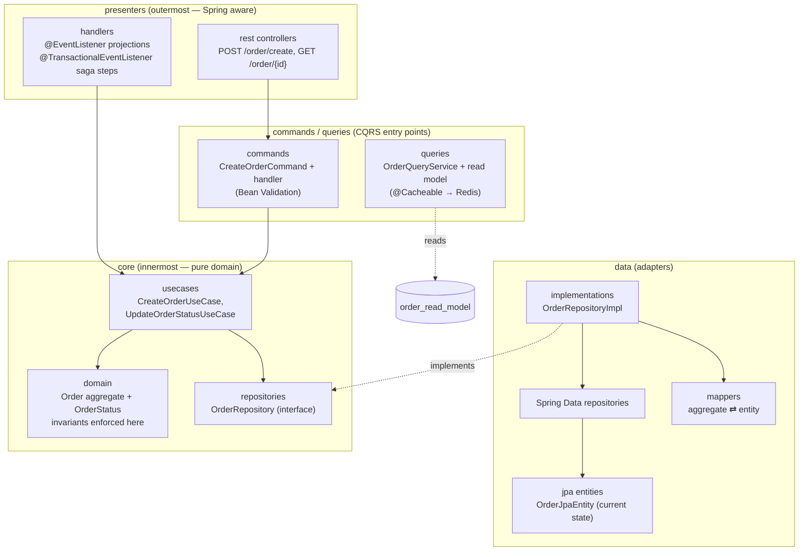

# Layer diagram — Clean Architecture inside every module

Each bounded-context module follows the same dependency rule: **outer layers know inner layers, never the reverse.** The core (`domain`) has zero Spring/JPA imports.

Dependency direction: `presenters → commands/queries → core` and `data → core`. The core defines repository **interfaces**; `data` provides the JPA implementation (dependency inversion).

| Layer          | May depend on                      | Must NOT depend on            |
|----------------|------------------------------------|-------------------------------|
| core/domain    | shared-kernel value objects        | Spring, JPA, other modules    |
| core/usecases  | core/domain, repository interfaces | JPA, other modules            |
| data           | core (implements interfaces)       | other modules                 |
| presenters     | commands/usecases/queries          | other modules (events only via shared-kernel) |
