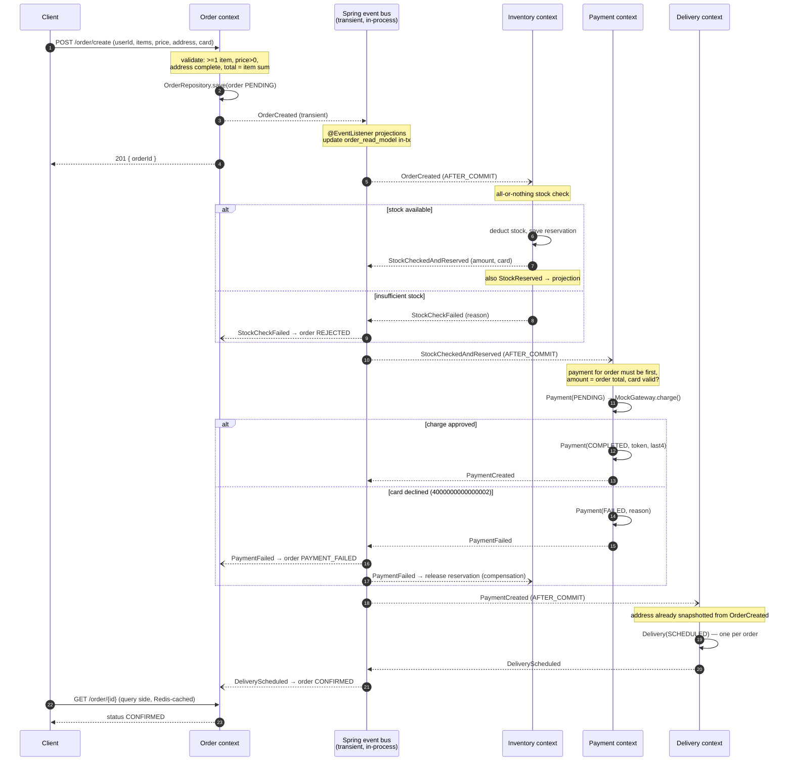

# Order saga sequence — choreographed, in-process events

Failure handling (BUSINESS_LOGIC.md §10):
- stock fails → `REJECTED`, no payment attempted
- payment fails → `PAYMENT_FAILED` + stock released (compensation)
- delivery fails → `DELIVERY_FAILED` (payment refund: future enhancement)
